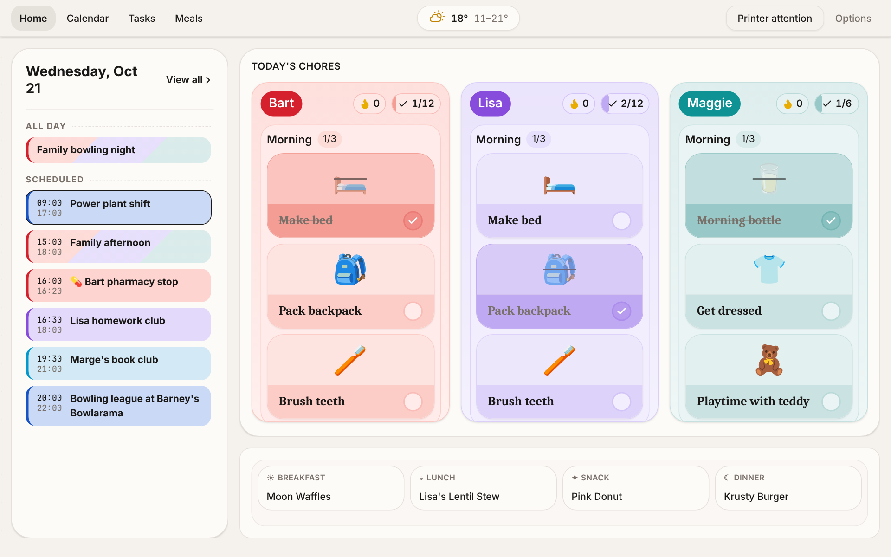

# Marplanner

Marplanner is a self-hosted household planner for a shared display. It combines
calendar and external feeds, day periods, routines and chores, reminders, meals,
daily messages, weather, spoken time, network devices, printing, daily briefings,
telemetry, and backup/restore. Optional features are installed plugins: activate
them from Admin → Plugins before configuring their contributions.

The family navigation provides Home, Calendar, Chores and Meals. Administration
owns household settings, member profiles, content, integrations and recovery.
English and Spanish are supported. External providers and physical devices need
operator configuration; synthetic test success does not establish their availability.



## Features

**For the family:**

- **Home dashboard:** today's agenda, chores, meals and weather at a glance.
- **Routines & chores:** routines grouped by part of the day, emoji chores assigned to each child on chosen weekdays, and streaks.
- **Meals & recipes:** a recipe catalogue, repeating weekly plans and one-off meals.
- **Daily briefing, printed:** a personal paper slip for each child every morning, sent from the browser to a thermal printer over Bluetooth.
- **Calendar:** local events plus ICS feeds, with automatic member assignment and emoji highlights.
- **Reminders & daily messages**, **spoken time announcements**, **network device blocking (UniFi)** and **weather**.

**For whoever runs it:**

- Plugins you turn on or off.
- Closed-by-default kiosk security.
- Backups and restore.
- Docker or one-click cloud demos.
- English and Spanish.

**For developers:**

- An API-first design: the UI uses the same documented HTTP API you can script against. See the [API guide](docs/api/README.md) and the [API reference](https://petstore.swagger.io/?url=https://raw.githubusercontent.com/diegomarino/marplanner/main/docs/api/openapi.json).

Take the [feature tour](docs/guide/README.md) for screenshots, or browse the [feature specs](docs/features/README.md).

## Try it in your own cloud

Each button creates your own Marplanner instance on that host, filled with the
fictional Simpsons household (members, calendar, chores, reminders and meals for
the current week). Nobody runs a shared demo: the instance is yours, in your account.

[](https://render.com/deploy?repo=https://github.com/diegomarino/marplanner)
[](https://app.koyeb.com/deploy?type=git&repository=github.com%2Fdiegomarino%2Fmarplanner&branch=main&name=marplanner&builder=dockerfile&dockerfile=infra%2Fdocker%2FDockerfile&instance_type=free&instances_max=1&ports=3000%3Bhttp%3B%2F&hc_protocol%5B3000%5D=http&hc_path%5B3000%5D=%2Fhealth&hc_method%5B3000%5D=get&hc_grace_period%5B3000%5D=30&env%5BMP_ACCESS_TOKEN%5D=mpg-local-change-me&env%5BMP_BOOTSTRAP_KEY%5D=mpk-local-bootstrap-change-me&env%5BADMIN_PIN%5D=0000&env%5BMP_SEED_ON_EMPTY%5D=true&env%5BPORT%5D=3000)
[](https://cloud.digitalocean.com/apps/new?repo=https://github.com/diegomarino/marplanner/tree/main)

<!-- TODO: Railway is configured (railway.json) but its button needs a published template. Once
it exists, add [](https://railway.com/deploy/<code>?utm_medium=integration&utm_source=button&utm_campaign=marplanner)
here (steps in docs/operations.md#one-click-cloud-demo). -->

The instance starts with the public default credentials from `.env.example`, and
every sign-in screen shows them prefilled: access token `mpg-local-change-me`,
bootstrap key `mpk-local-bootstrap-change-me`, admin PIN `0000`.

> [!WARNING]
> Anyone who has read this README can open a demo instance. It is a demo, not a
> household install: for real use, set your own `MP_ACCESS_TOKEN` (`mpg-` prefix),
> `MP_BOOTSTRAP_KEY` (`mpk-` prefix) and `ADMIN_PIN`, and drop `MP_SEED_ON_EMPTY`,
> on fresh storage. Changing them later does not revoke the default bootstrap key or
> devices already provisioned on a host that keeps its data (see
> [operations](docs/operations.md#one-click-cloud-demo)). The on-screen notices
> disappear once the defaults are gone.

| Host                                          | Cost of the demo              | Data on restart or redeploy                       |
| --------------------------------------------- | ----------------------------- | ------------------------------------------------- |
| Render                                        | Free web service              | Lost (no disk on the free plan; sleeps when idle) |
| Koyeb                                         | Free instance                 | Lost (no volumes on the free instance)            |
| Railway (button pending a published template) | Free or trial credit          | Kept only if you attach a volume at `/data`       |
| DigitalOcean                                  | Smallest paid service ($5/mo) | Lost (App Platform has no persistent volumes)     |

When data is lost, the next boot seeds the Simpsons again. Run one instance only:
the server refuses a second process on the same database. More detail, including
how to keep data, is in [operations](docs/operations.md#one-click-cloud-demo).

## Requirements

- Node.js `>=24.21.0 <25` (development and CI use `24.21.0`)
- npm `11.19.0` for the pinned development environment
- A writable, persistent directory for application data

## Install and start

```sh
npm ci
npm run build
DATA_DIR=/path/to/persistent/marplanner npm start
```

Create the data directory before starting and grant the server process write access. The server listens on `0.0.0.0:3000` by default; set `HOST` and `PORT` for your deployment. Shut it down with `SIGINT` or `SIGTERM` and allow the process to drain. The SQLite database defaults to `DATA_DIR/marplanner.db`; `DATABASE_PATH` can override its filename. With no `DATA_DIR`, storage falls back to the working directory, which is unsuitable for a disposable deployment directory.

The app fails closed until the operator configures credentials. Put unique secret values in the deployment environment. For local development, copy `.env.example` to the ignored `.env.local` and replace every sample value; exported variables take precedence. `npm start` and the seed commands load `.env.local` when present. Never publish populated credential files.

| Setting             | Boundary                                                                                                                        |
| ------------------- | ------------------------------------------------------------------------------------------------------------------------------- |
| `MP_ACCESS_TOKEN`   | Frontend access gate. Without it, browser access cannot pass the gate.                                                          |
| `MP_BOOTSTRAP_KEY`  | Deployment bootstrap device credential. Without it, first-device provisioning remains locked.                                   |
| `MP_MANAGEMENT_KEY` | Optional operator credential for management capabilities. Rotating the environment value does not revoke an already issued key. |
| `ADMIN_PIN`         | Initial advisory UI PIN. It does not authorize backend requests. Set a unique value; the code's fallback is `0000`.             |
| `MP_SEED_ON_EMPTY`  | Optional. `true` seeds the public Simpsons demo on the first boot of an empty database; data already present is never touched.  |

See [operations](docs/operations.md) for provisioning, storage, shutdown, and synthetic public seed guidance. See [security](SECURITY.md) before exposing the service beyond a trusted network.

## Container installation

Docker Engine and Docker Compose are required. From the repository root:

```sh
cp infra/docker/.env.example infra/docker/.env.local
# Fill MP_ACCESS_TOKEN (mpg- prefix), MP_BOOTSTRAP_KEY (mpk- prefix), ADMIN_PIN.
docker compose --env-file infra/docker/.env.local -f infra/docker/compose.yaml -p marplanner-home up --build -d
docker compose --env-file infra/docker/.env.local -f infra/docker/compose.yaml -p marplanner-home port marplanner 3000
```

Open the reported loopback address. Compose allocates the host port automatically;
set `PUBLISHED_PORT` for an explicit port. Use a distinct project name for each
installation to isolate ports and persistent volumes. The image runs as the
non-root `node` user and stores SQLite and backups in `/data`. See
[container operations](docs/operations.md#container-installation) for ownership,
HTTPS, shutdown, upgrades, [subpath hosting with `BASE_PATH`](docs/operations.md#runtime-subpath-hosting)
and the single-instance limit.

## Development and verification

```sh
npm ci
cp .env.example .env.local
npm run dev
```

Replace the synthetic credentials in `.env.local`. `npm run dev` starts the API and frontend on distinct automatically assigned loopback ports and reports both URLs. Each worktree stores its development data in its own `.data/`. Set `PORT` and `WEB_PORT` to distinct nonzero values when explicit ports are needed; occupied explicit ports fail. The `package.json` scripts define the current check tiers: `npm run check:fast`, `npm run check:standard`, and `npm run check:full`. The full tier includes browser tests and requires their local browser dependencies. A passing focused tier is evidence for that tier only. [Verification guidance](docs/quality/verification.md) explains discovery, coverage, and cross-consumer checks.

[Feature tour](docs/guide/README.md) · [Contributor guide](CONTRIBUTING.md) · [Architecture](docs/architecture/principles.md) · [API guide](docs/api/README.md) · [API reference](https://petstore.swagger.io/?url=https://raw.githubusercontent.com/diegomarino/marplanner/main/docs/api/openapi.json) · [License](LICENSE)
