# Marplanner feature tour

Marplanner turns a tablet on the wall into the household's shared brain: what's on
today, who still has chores to do, what's for dinner, and a printed briefing for each
kid in the morning. Everything runs on your own server, behind your own credentials.

Every screenshot below comes from the public **Simpsons demo household** that the
one-click deploy buttons seed. Regenerate them with `npm run docs:screenshots` (see
[Regenerating the screenshots](#regenerating-the-screenshots)).

**For the family:**

1. [Home: today at a glance](#1-home-today-at-a-glance)
2. [Routines and chores with streaks](#2-routines-and-chores-with-streaks)
3. [Meals and recipes](#3-meals-and-recipes)
4. [Daily briefing, printed on a thermal printer](#4-daily-briefing-printed-on-a-thermal-printer)
5. [Shared calendar and ICS feeds](#5-shared-calendar-and-ics-feeds)
6. [Reminders and daily messages](#6-reminders-and-daily-messages)
7. [Spoken time announcements](#7-spoken-time-announcements)
8. [Network devices (UniFi)](#8-network-devices-unifi)
9. [Weather](#9-weather)

**For whoever runs it:**

10. [Plugins: turn features on and off](#10-plugins-turn-features-on-and-off)
11. [Security for a kiosk](#11-security-for-a-kiosk)
12. [Backups and restore](#12-backups-and-restore)
13. [Self-hosted, with one-click demos](#13-self-hosted-with-one-click-demos)
14. [English and Spanish](#14-english-and-spanish)

**For developers:**

15. [API-first](#15-api-first)

---

## 1. Home: today at a glance

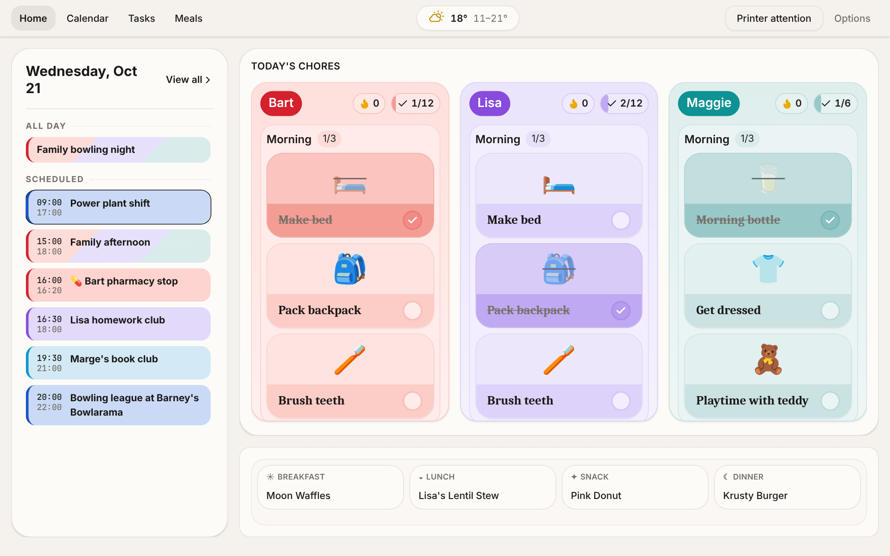

The Home screen is what the tablet shows all day. One glance from the kitchen
answers the three questions every family asks each morning:

- **What's happening today?** The agenda lists all-day events, then timed events in
  order. Each event is painted in the colours of the members it involves.
- **Who still has chores to do?** There is one column per child for the current part
  of the day, with big emoji tiles that are easy to tap. A progress badge and a
  streak counter (🔥) sit next to each name.
- **What are we eating?** Breakfast, lunch, snack and dinner are shown straight from
  the meal plan.

The top bar carries the weather pill and the printer status, and a long press opens
the admin area (see [Security for a kiosk](#11-security-for-a-kiosk)).

| Agenda                                        | Meals strip                                 |
| --------------------------------------------- | ------------------------------------------- |
| 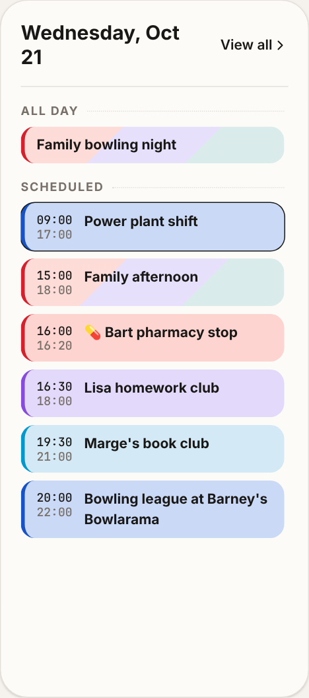 | 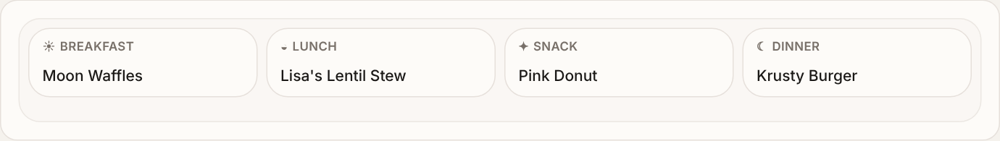 |

Specs: [kiosk shell & navigation](../features/kiosk-shell-navigation.md)

## 2. Routines and chores with streaks

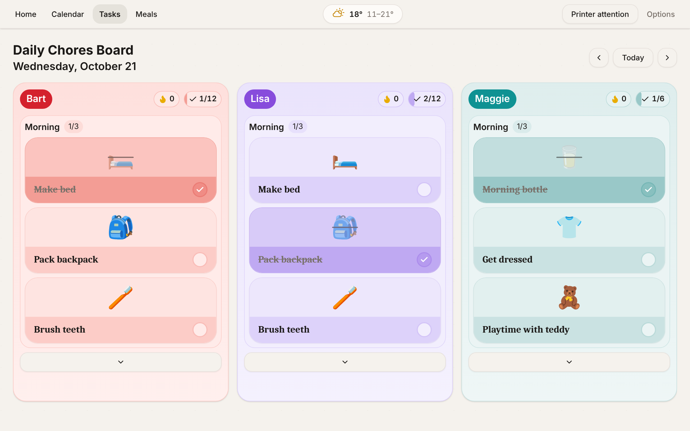

Chores in Marplanner are built for kids, not for a to-do app:

- A **routine** ("Morning launch", "After school", "Bedtime") belongs to a part of the
  day: morning, afternoon, evening or night. It holds an ordered list of chores, each
  with its own emoji.
- You **assign** a routine to one or more children on chosen weekdays, for example
  Bart and Lisa from Monday to Friday.
- Children tick chores off on the tablet. A parent can go back to a past day and fix a
  missed tick, without any special override.
- **Streaks** count the days in a row on which a child finished all their chores.
  They are worked out from the completions every time they are shown, so they are
  never stored and can never drift. Reorganise the routines and the streak simply
  follows the new set-up.

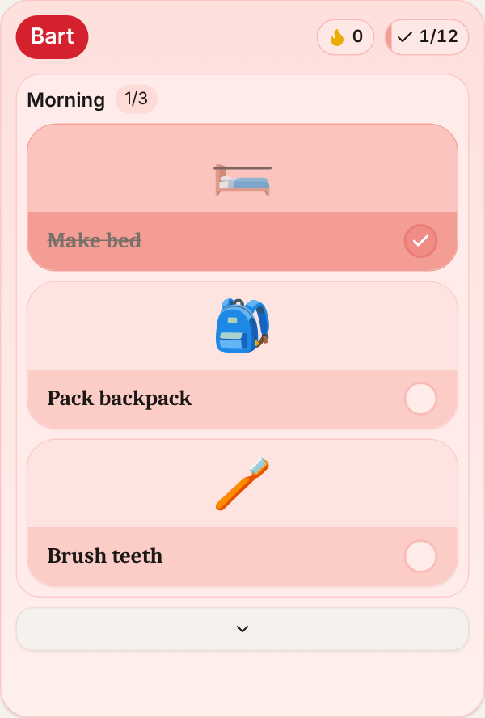

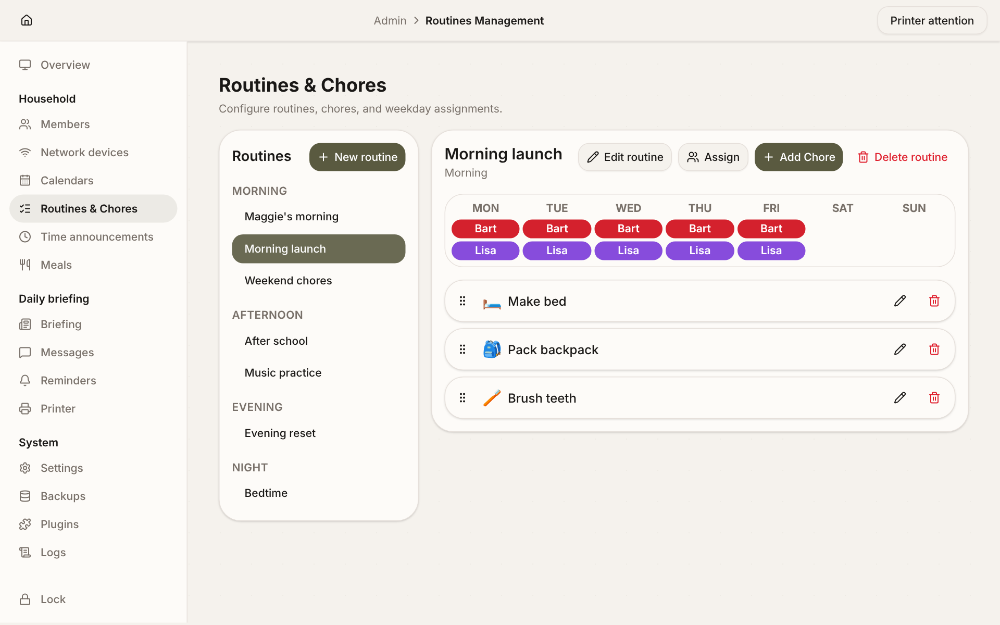

Specs: [routines & chores](../features/routines-chores.md) ·
[day periods](../features/day-periods.md) · API: [chores](../api/README.md#domains)

## 3. Meals and recipes

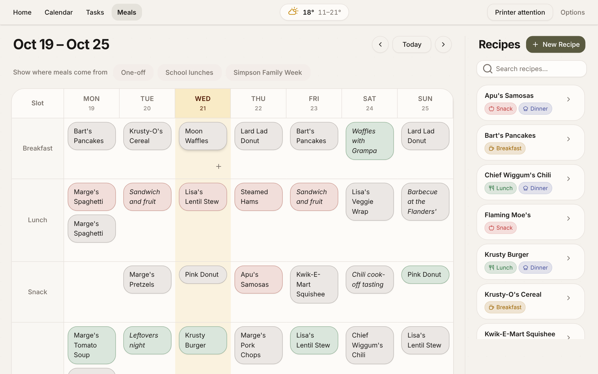

Meal planning is built for how families really eat: mostly the same weekly pattern,
with a few exceptions.

- **Recipes** form a catalogue. Each one is tagged with the slots it suits
  (breakfast, lunch, snack, dinner).
- **Meal plans** are repeating templates with no end date, such as "Simpson Family
  Week" or "School lunches", that say what you usually eat.
- **One-off entries** cover the exceptions: "Barbecue at the Flanders'".
- The weekly **menu** is put together from all of these each time it is viewed, and
  nothing is ever overwritten. Adding an entry never removes another one. The
  origin pills show where each meal comes from.

The same menu appears on the Home screen and is copied into the printed daily
briefing.

| Weekly plan                                               | Recipe catalogue                                 |
| --------------------------------------------------------- | ------------------------------------------------ |
| 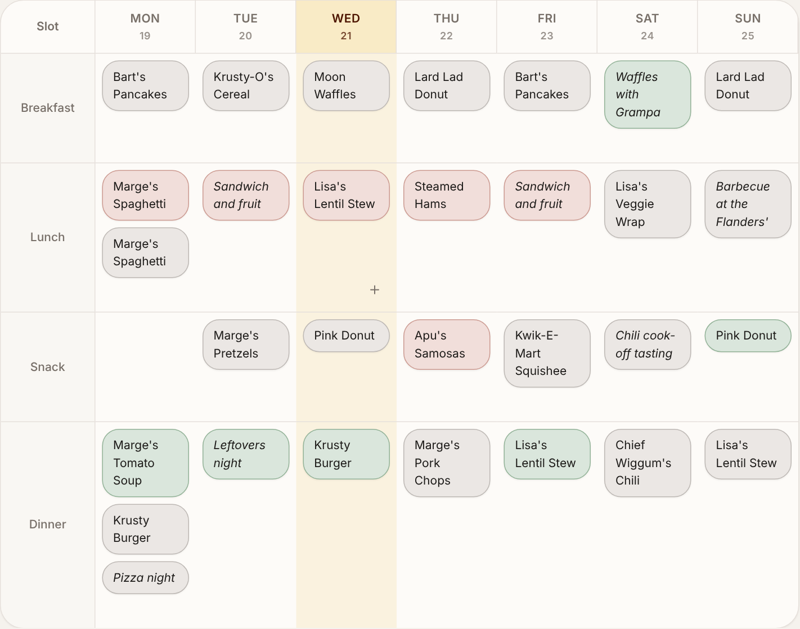 | 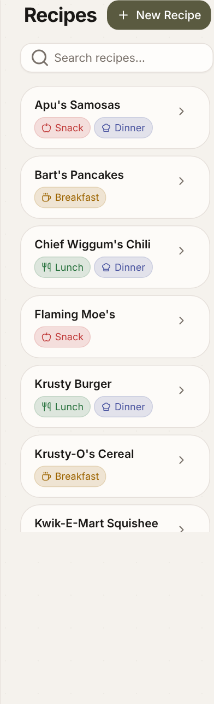 |

Specs: [meals & recipes](../features/meals-recipes.md) · API: [meals](../api/README.md#domains)

## 4. Daily briefing, printed on a thermal printer

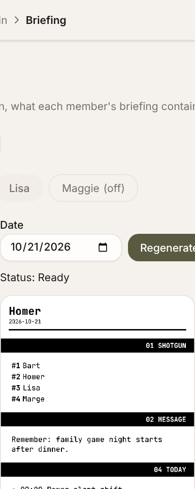

This is the feature that makes Marplanner different. Every morning, each child can
get a **personal paper slip** from a cheap Bluetooth thermal printer next to the
tablet. Nothing to read on a screen: they take it to the breakfast table.

A briefing is built for one member on one date, from more than 20 kinds of
content block:

- **Household content:** today's events, meals, weather, reminders, the daily message
  from a parent, birthday countdowns, chore streaks, and the "shotgun" ranking (who gets
  the front seat).
- **Fun content:** dad joke, word of the day, animal fact, number fact, on this day,
  quote of the day, trivia, riddle (printed upside down), would you rather, a word
  search and a drawing prompt with an empty box to fill in.

You choose who gets a briefing, on which days, and which blocks it contains. Each
briefing is a **frozen snapshot**: a printed slip never changes afterwards. It only
changes if you regenerate it on purpose.

**Printing** is a separate, general-purpose plugin. It takes any printable image,
converts it to ESC/POS for your paper width, and sends it to the printer over
**Web Bluetooth** straight from the kiosk browser. No print server, no drivers. It
can also print automatically as soon as a child finishes their morning chores.

<br clear="right">

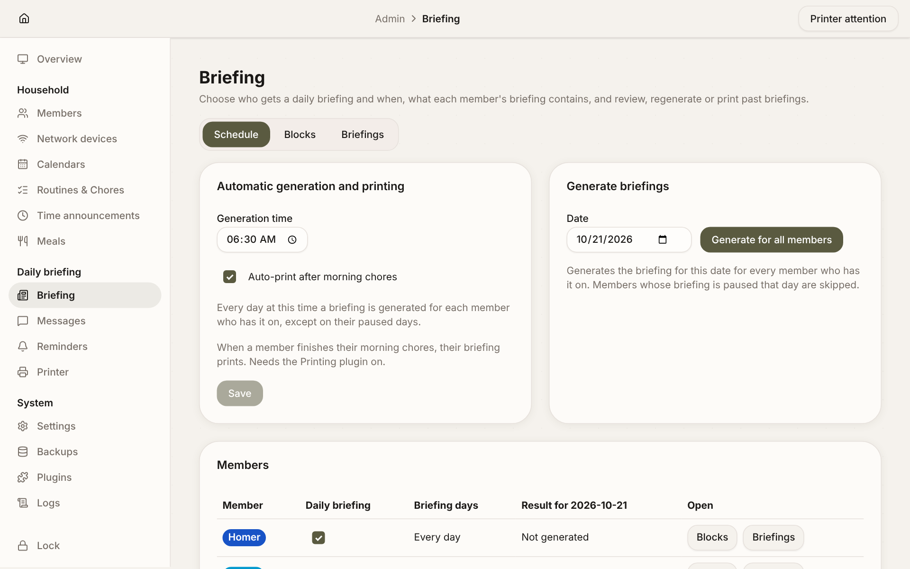

<details>
<summary>See a full briefing slip</summary>

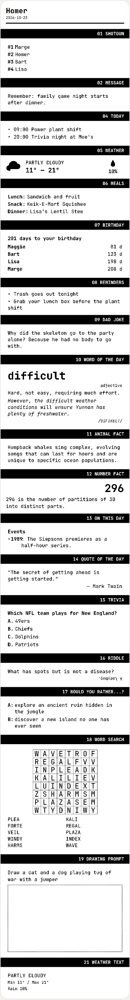

</details>

Specs: [daily briefing](../features/daily-briefing.md) · [printing](../features/printing.md) ·
API: [daily briefing](../api/README.md#domains), [printing](../api/README.md#domains)

## 5. Shared calendar and ICS feeds

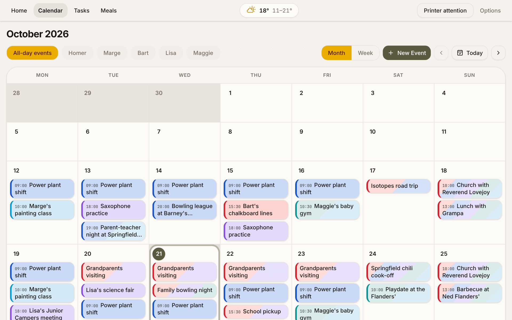

- **Month and week views**, with filters per member and for all-day events.
- **Local events** are created on the tablet or in admin. **ICS feeds** (school,
  public holidays, sports fixtures, astronomy…) are subscribed to and kept in sync in
  the background.
- **Automatic assignment to members:** an event titled "Lisa's science fair" goes to
  Lisa, whether it comes from a feed or not.
- **Emoji highlights:** keyword rules (`pharmacy` → 💊, `music lesson` → 🎵) decorate
  titles when they are shown, without changing the stored event.

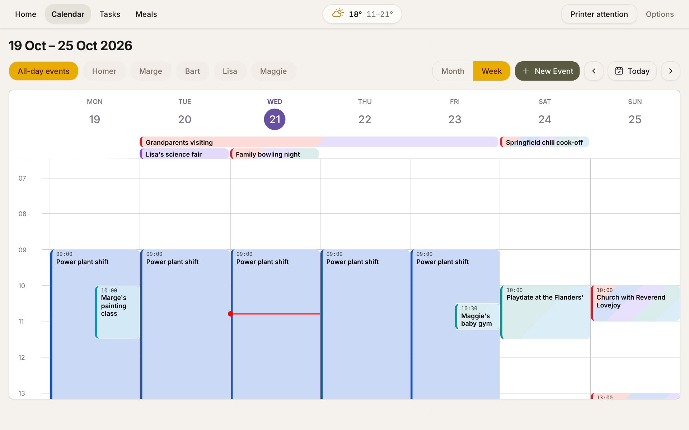

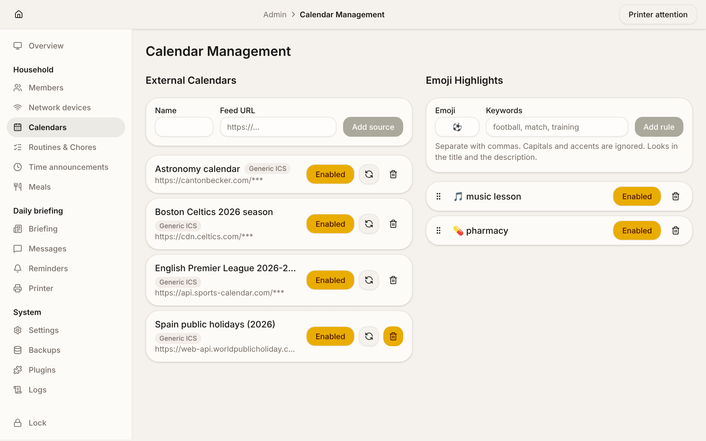

Specs: [calendar](../features/calendar.md) · API: [calendar](../api/README.md#domains)

## 6. Reminders and daily messages

Two small tools that feed the daily briefing:

- **Reminders** are reusable prompts written by parents ("Pack your school bag",
  "Bring the signed permission slip"). They can repeat on chosen weekdays, or appear
  only on days when a matching calendar event exists.
- **Daily messages** are sticky notes for one member on one date: "Remember: family
  game night starts after dinner."

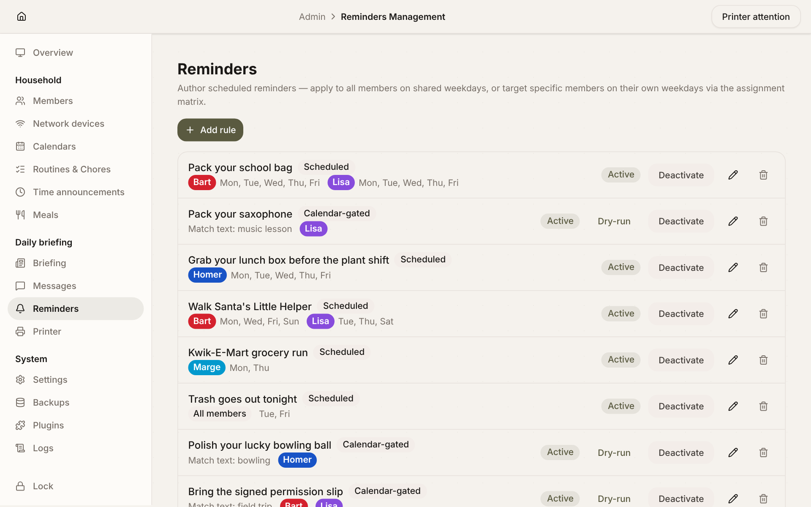

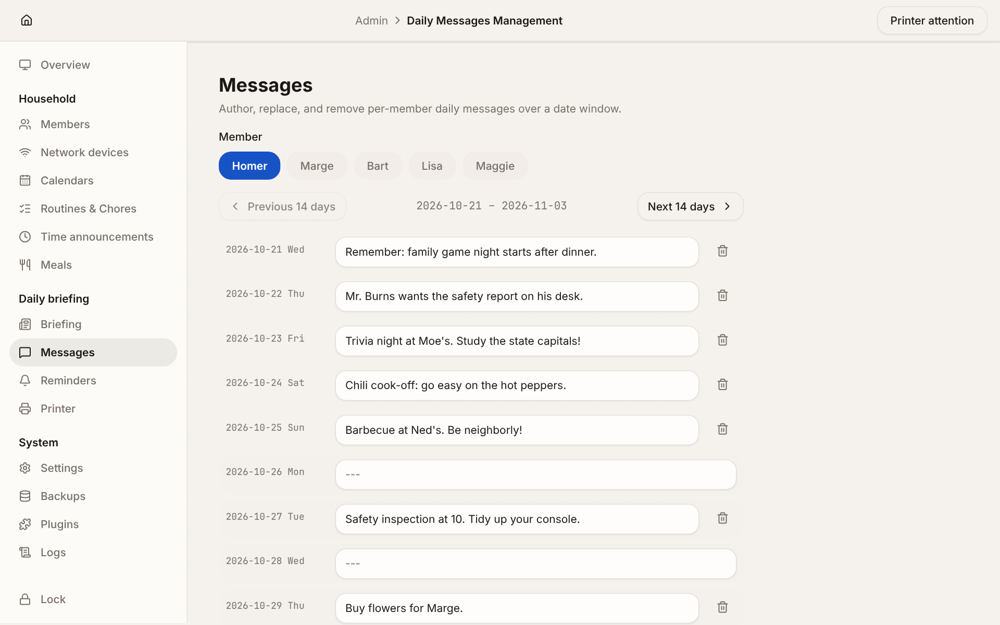

Specs: [reminders](../features/reminders.md) · [daily messages](../features/daily-messages.md)

## 7. Spoken time announcements

The tablet **says the time out loud** at the moments that matter, such as 07:00,
08:15 ("shoes on!") or 20:30, on the weekdays you choose. It uses the browser's
built-in speech, in the household language. When the kiosk has several tabs open,
only one of them speaks, so announcements are never doubled.

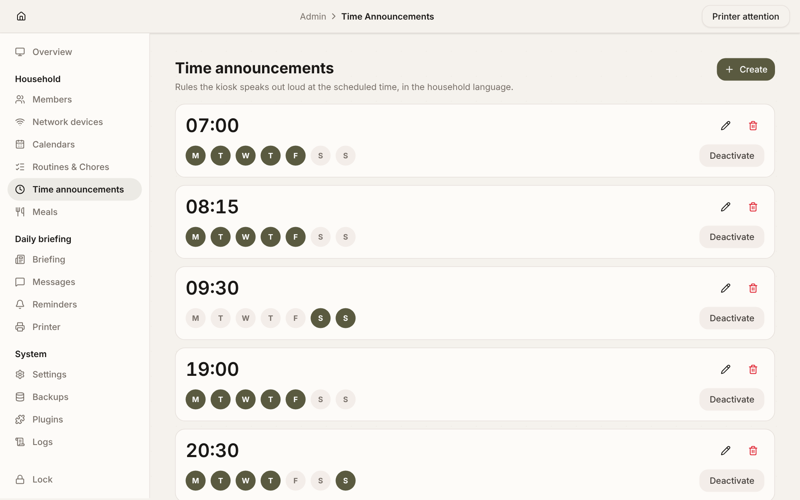

Specs: [time announcements](../features/time-announcements.md)

## 8. Network devices (UniFi)

Keep a list of the household's devices with friendly names, assign each one to a
member, and **block or restore its internet access** from the admin area. Handy at
dinner time. It works with a UniFi controller, which stays the source of truth for
whether a device is connected. Requires `UNIFI_*` configuration (see
[operations](../operations.md)).

Specs: [network devices](../features/network-devices.md)

## 9. Weather

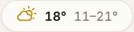

The current conditions and the day's high and low appear in the top bar, and a
weather block is included in the daily briefing. Data comes from Open-Meteo for one
location you configure, with no API key needed. Weather is never critical: if the
provider is unreachable, nothing else is blocked.

Specs: [weather](../features/weather.md)

---

## 10. Plugins: turn features on and off

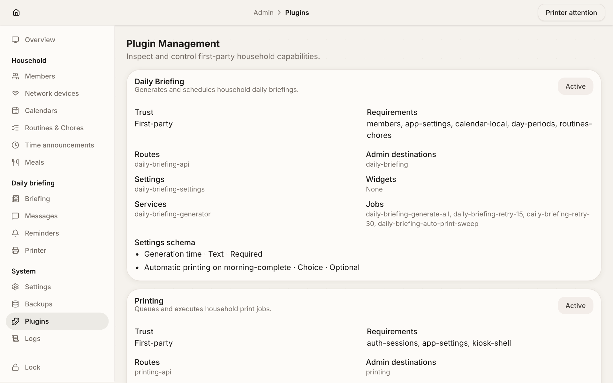

Meals, reminders, daily messages, daily briefing, printing, weather, time
announcements, network devices and backups are all **plugins**. Each one can be
switched on or off from Admin → Plugins.

- Each plugin declares the routes, settings, admin pages, widgets and background jobs
  it adds.
- A plugin keeps its data in its own tables and talks to the rest of the app only
  through a host API that is passed to it.
- If a plugin fails, the failure stays inside it: the rest of the household app keeps
  working.

Specs: [plugin system](../features/plugin-system.md) ·
[plugin manifest matrix](../architecture/plugin-manifest-matrix.md)

## 11. Security for a kiosk

A wall tablet is a shared, unattended device, and the security model is built
around that:

- **Closed by default.** With no credentials configured, only `/health` responds.
- **Access token** (`MP_ACCESS_TOKEN`): the front gate a browser must pass.
- **Device provisioning** (`MP_BOOTSTRAP_KEY`): each tablet is enrolled once and
  receives its own device key in an httpOnly cookie.
- **Scoped keys:** every request is checked against `domain:verb` permissions. A
  separate management key (`MP_MANAGEMENT_KEY`) is reserved for plugin management.
- **Admin PIN:** a long press followed by a touch keypad stops little hands from
  reaching the admin area. It is a deliberate barrier against accidental access,
  not a password: the backend never trusts it.
- Repeated failed attempts are rate-limited (`429` with `Retry-After`).

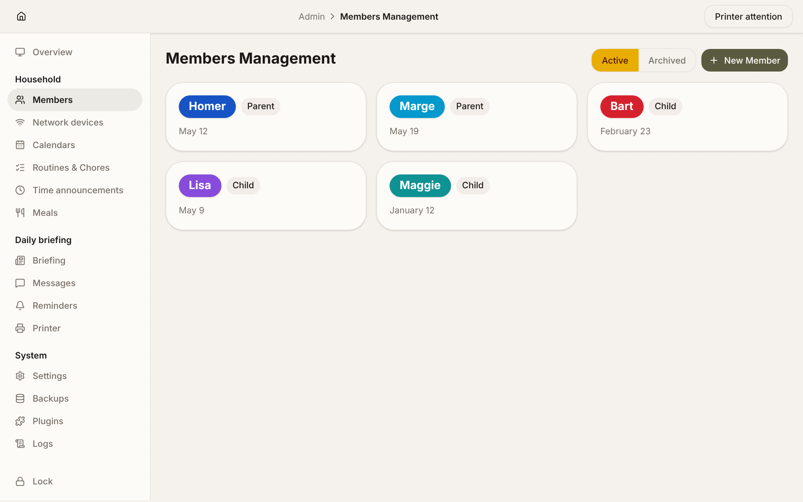

Specs: [auth & sessions](../features/auth-sessions.md) · [members](../features/members.md) ·
[SECURITY.md](../../SECURITY.md)

## 12. Backups and restore

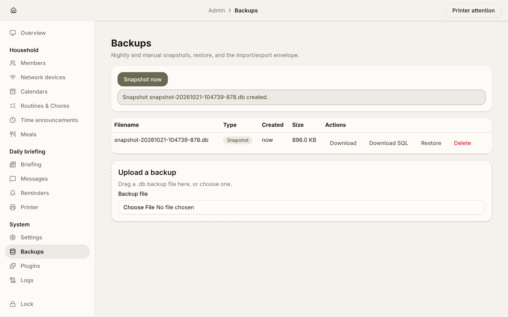

- Take a snapshot whenever you like, and nightly snapshots are taken automatically.
- **Download** a backup as a `.db` file or as a read-only SQL export, **import** a
  `.db` file, and **restore** it.
- A restore replaces the whole database, never part of it. It is checked against the
  versions and database migrations the app supports, and a snapshot is taken
  automatically just before, so you can always go back.

Specs: [backups](../features/backups.md)

## 13. Self-hosted, with one-click demos

- **Single process, single SQLite file.** It runs on a Raspberry Pi, a NAS or a
  small VPS.
- **Docker image** with a Compose file, running as a non-root user and storing its
  data in `/data`.
- **One-click demos** on Render, Koyeb, Railway and DigitalOcean, already filled with
  the Simpsons household. See the [README](../../README.md#try-it-in-your-own-cloud).

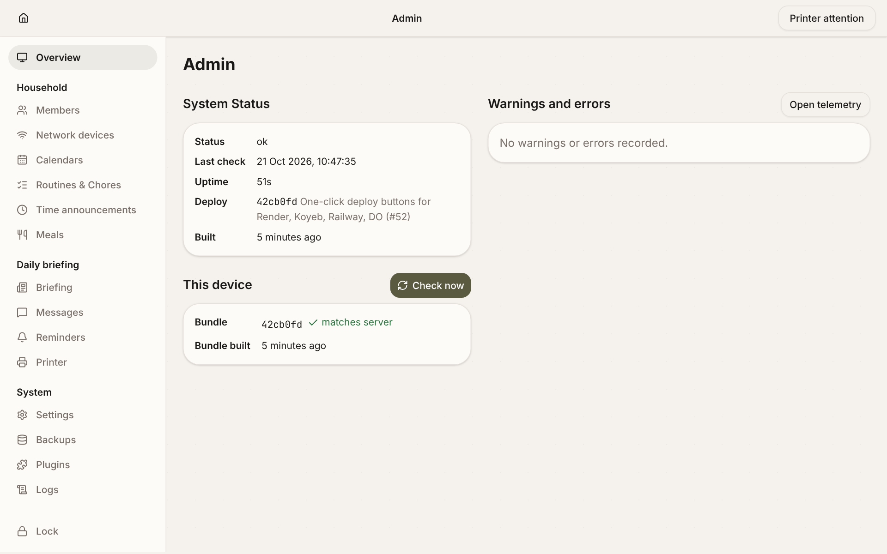

Specs: [operations](../operations.md)

## 14. English and Spanish

The whole interface, generated text and date formats follow the household language,
which you switch in Settings. A check in the build stops a release if the two
languages fall out of step.

| English                                           | Español                                              |
| ------------------------------------------------- | ---------------------------------------------------- |
|  | 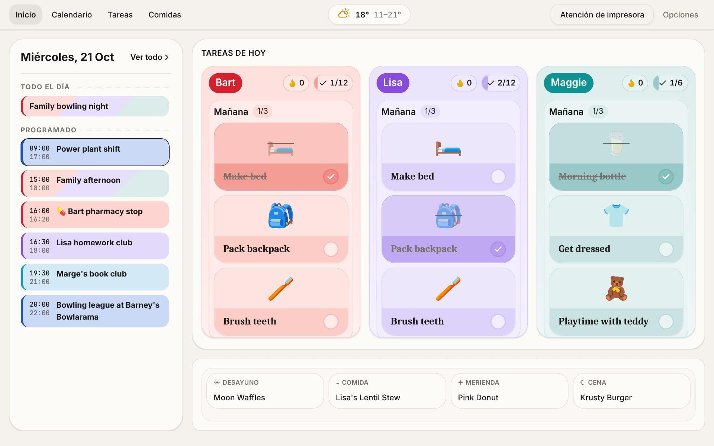 |

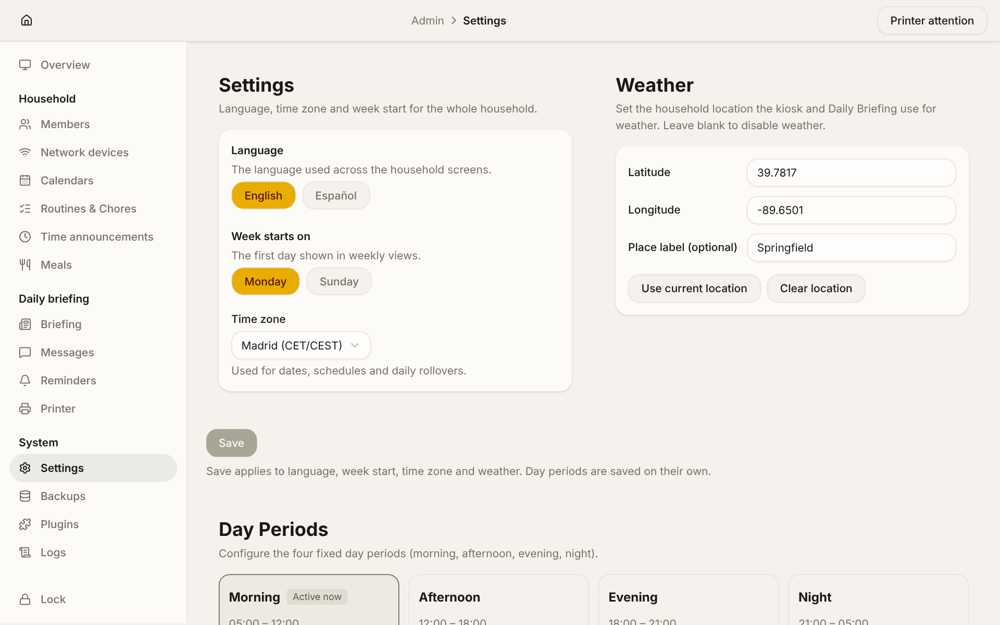

Specs: [i18n & localization](../features/i18n-localization.md) ·
[app settings](../features/app-settings-registry.md)

---

## 15. API-first

Everything the tablet does goes through the same HTTP API that is open to you. There
are no private endpoints just for the UI.

- An **OpenAPI 3.1 document** generated from the code. Every route declares its
  schema, covering more than 120 operations.
- **Script it with the same credentials as a tablet:** provision a device key once,
  then call the API from cron jobs, Home Assistant or your own dashboards.
- A typed **domain event catalogue** and a **background job scheduler**, used by
  plugins.

- An **interactive reference** at `/api/docs/` on every instance. It is generated
  from the route schemas in the code, and CI fails if it falls out of date.

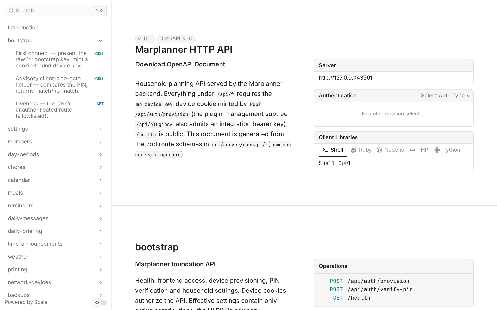

Start with the [API guide](../api/README.md).

---

## Regenerating the screenshots

```sh
npm run build
npm run docs:screenshots                  # all shots
npm run docs:screenshots -- --only home   # shots whose name starts with "home"
```

The script seeds the **public** demo profile only, never the private overlays, into
a temporary data directory. It starts the built server against a local
weather/quote stand-in, so no real network calls are made, and drives Chromium at a
1280×800 kiosk viewport. Output goes to `docs/images/features/`. If you use a
preinstalled Chromium, set `PLAYWRIGHT_CHROMIUM_PATH`.
