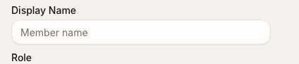
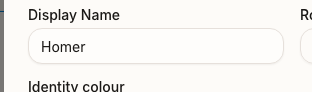
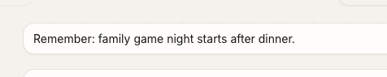
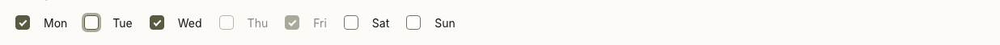
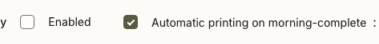
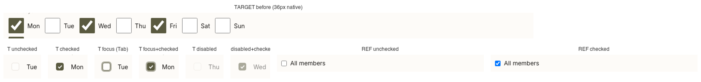
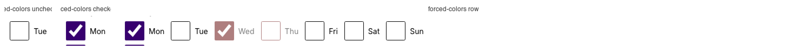

# UI parity with the reference app — audit

**Date:** 2026-10-13
**Spec:** [2026-10-13-ui-parity-design.md](2026-10-13-ui-parity-design.md)
**Branch:** `feat/ui-parity`
**Reference commit:** `f4c1c46` (`<marplanner-v1>`, `main`)

Status values: `pending` (not started), `matched`, `skipped`, `deferred`. The agent updates this
column after each component; a component is never left `pending` at wrap-up.

## How both apps run

| Side      | Command                                                                                                  | Ports                               | Data                                                     |
| --------- | -------------------------------------------------------------------------------------------------------- | ----------------------------------- | -------------------------------------------------------- |
| Target    | `PORT=3200 WEB_PORT=5373 npm run dev:fresh` (Node 24)                                                    | API 3200, web 5373                  | Disposable `.data-fresh`, public then private seeds      |
| Reference | `pnpm dev:back`, `pnpm dev:front` and `storybook dev`, each started directly under `fnm exec --using=22` | API 3100, web 5273, Storybook 61100 | Disposable SQLite file outside the repository, full seed |

Answers to the spec's open points:

- **`DATABASE_PATH` is overridable per run.** `apps/api/src/db/client.ts` and
  `apps/api/drizzle.config.ts` both read `process.env.DATABASE_PATH`, and Node's `--env-file` does
  not override an exported variable. The disposable database was created with
  `drizzle-kit migrate` and `pnpm db:seed:full`, both run with `DATABASE_PATH` pointing at a
  scratch file. The API log line "Members already exist, skipping members seed" confirms the
  server opened that file.
- **`pnpm dev:restart` was not used.** It starts the servers through tmux `send-keys`, so the
  panes take their environment from the tmux server and an exported `DATABASE_PATH` would not
  reach the API, which would then fall back to the real `sqlite.db`. The same three processes are
  started directly with explicit environment instead. `pnpm dev:status` showed nothing running
  beforehand.
- **Node version.** The reference pins Node 22 and its `better-sqlite3` binding is built for it,
  so it runs under `fnm exec --using=22`. Nothing in its `node_modules` was rebuilt.
- **The real database is unchanged.** `apps/api/sqlite.db` had SHA-256
  `4d2c871f948c07191ab7c11ad6677af281c44e15746b443fb112c7a594cd7982`, 2,584,576 bytes and mtime
  1790094872 before setup, and the same three values after migrating, seeding and starting the
  servers. It is checked again at wrap-up.
- **Logs.** `LOG_DIR` and the New Relic agent are redirected or disabled through environment
  variables, so the reference working tree stays as it was (`git status` there is unchanged).

Captures are taken with Playwright (the version already installed here) at 1280×800, comfortable
density, reduced motion. The capture scripts and screenshots live in the session scratchpad and
are not committed. The target is unlocked through the access gate, device provisioning and the
admin PIN keypad; the reference through its connection screen and the admin session its own
end-to-end helper sets up.

## Findings that shape the work

1. **The semantic palette already matches.** `src/client/styles/tokens.css` holds the same values
   the reference resolves to (see the token map). Colour work under this goal is small.
2. **Typography is the largest visible difference, and the fonts are not loaded here.** The
   reference loads Inter (body), Outfit (headings) and JetBrains Mono from Google Fonts through
   `<link>` tags in its `index.html`. This repository has no font loading; text renders in the
   system font. The tokens phase adds the font stacks as theme tokens so components can name
   `font-display`, but they resolve to the system fallback until the fonts are served. Loading
   them needs a decision that is outside this goal (a third-party request from a household kiosk,
   or self-hosted font files, plus `index.html`); it is recorded under
   [Deferred decisions](#deferred-decisions).
3. **Control size belongs to the density contract.** `docs/ui/component-contract.md` fixes control
   height and control text to the density tokens (36px and 14px at comfortable). The reference
   sizes controls per call site (inputs and form buttons at 48px, native checkboxes at 13px).
   Height and control text size are therefore not parity targets here; shape, colour, shadow,
   spacing and states are.
4. **The reference has no generic `Dialog` primitive.** Its modal surfaces are `ModalOverlay`,
   `ConfirmDialog` and `Sheet`. `dialog` here is compared against `ModalOverlay` and
   `ConfirmDialog`.

## Reviewer requirements beyond source parity

Corrections relayed by the reviewing session during execution. They take precedence over what the
reference source does.

1. **Form field surfaces (2026-10-13).** The background of a form field must read lighter than
   the surface it sits on. In the reference, `input` and `textarea` are `bg-transparent`, but its
   forms sit inside `bg-card` modals, so fields look lighter than the page. Here forms often sit
   directly on the beige page, where a transparent field looks the same as the page. `input`,
   `textarea` and the `select` trigger therefore get a surface that is visibly lighter than the
   page background and not darker than a card or dialog surface. Diego chose a dedicated
   semantic token, `--field`, over reusing `--popover`: a warm off-white closer to pure white
   than to the page background and at least as light as `--card`. It is added in its own commit
   and applied by the `input`, `textarea` and `select` components. `Field` and the dialog forms
   are re-checked against this.
   **Chosen value:** `--field: #fefdfb` (rgb 254, 253, 251), defined in
   `src/client/styles/tokens.css` and exposed as `bg-field` through `--color-field` in
   `globals.css` (commit `4aaa2b4`). For comparison: page `--background` is `#f5f2ed`, `--card`
   and the dialog surface are `#fdfbf8`, pure white is `#ffffff`. Every captured field measures
   `rgb(254, 253, 251)` after the change.

   | A field on the page (`/admin`, member create)       | A field inside a dialog (`/admin/members` → Edit)       | Textarea on the page (`/admin/daily-messages`)            |
   | --------------------------------------------------- | ------------------------------------------------------- | --------------------------------------------------------- |
   |  |  |  |

   On the page the field is clearly lighter than its surroundings. Inside a card or dialog the
   step from `#fdfbf8` to `#fefdfb` is small by design ("at least as light as a card"), so there
   the border and shadow carry most of the definition.

   **Call-site overrides removed** (class removal only, one commit per feature file, so each can
   be reviewed or reverted):

   - `src/client/admin/DailyMessagesManagement.tsx`: `bg-background` removed from the daily
     message `Textarea` (14 instances on `/admin/daily-messages`).

   Every `Input`, `Textarea` and `SelectTrigger` call site in `src/client` was scanned for a
   background class; that was the only one, and none looked intentional.

   **Open item:** the `NATIVE_SELECT_CLASSES` recipe in `src/client/lib/recipes.ts` still uses
   `bg-transparent`. Native selects (the telemetry level filter, the single-mode weekday
   picker) are form fields, but the recipe is not one of the three components named and is not
   a call-site override, so it is unchanged pending a decision.

2. **Comparison crops (2026-10-13).** Full-page captures do not show small changes. Every
   component from `card` onwards has tight crops of the component itself, composed into one
   image per state: target before, target after, reference. `button` is not redone.

3. **Custom-drawn checkbox and radio (2026-10-13).** Replacing the native rendering is a bigger
   change than the other restyles, so each of the following is verified on the real target screen
   before commit, by the agent independently of the subagent's report. If any cannot be shown,
   the component keeps the native control and the size difference is deferred.

   `CheckboxField`, verified on `/admin/time-announcements` ("New rule") and
   `/admin/daily-briefing`:

   | Check                                | Result                                                                                                                                                                                                                                                                                                                                                                                                                     |
   | ------------------------------------ | -------------------------------------------------------------------------------------------------------------------------------------------------------------------------------------------------------------------------------------------------------------------------------------------------------------------------------------------------------------------------------------------------------------------------- |
   | Disabled is visibly distinct         | Yes. The label and box render at 50% opacity. No seeded screen has a disabled checkbox, so `disabled` and the component's own `opacity-50` were set by hand in the browser.                                                                                                                                                                                                                                                |
   | Keyboard focus ring shows            | Yes. Reached with Tab (`:focus-visible` true): the box border turns ring-coloured and gets the same 3px half-opacity ring as `Input`.                                                                                                                                                                                                                                                                                      |
   | Checked without colour alone         | Yes. A check mark is drawn (opacity 0 unchecked, 1 checked) on top of the fill.                                                                                                                                                                                                                                                                                                                                            |
   | Forced colours                       | Yes. Under forced-colours emulation the input computes `appearance: auto` and both pseudo-elements are `display: none`, so the platform checkbox is shown in system colours.                                                                                                                                                                                                                                               |
   | Click and label behaviour unchanged  | Yes. A click on the box, a click on the label text and Space while focused each toggle it, and `checked` follows. It is still an `INPUT` of type `checkbox` whose parent is the `LABEL`, 36px square.                                                                                                                                                                                                                      |
   | Unchecked border contrast (reviewer) | The first pass used `border-input`: 1.17:1 against the page and 1.27:1 against a card. It now uses `border-muted-foreground` (`oklch(0.55 0.015 60)`, rgb 120, 112, 105): **4.35:1 against the page** (`#f5f2ed`), 4.71:1 against a card (`#fdfbf8`), 4.78:1 against the box's own fill (`#fefdfb`). The 3:1 expected for a control boundary is met on every surface. Disabled stays at 50% opacity and is visibly weaker. |

   Unchecked, checked, focused, disabled and disabled-checked after the border change, on a card:

   

   Unchecked and checked directly on the page background (`/admin/daily-briefing`):

   

   Before, the states from the first pass (faint `border-input`, since replaced) and the
   reference's native checkbox:

   

   Under forced colours:

   

## Components

Screens are given as route, then the interaction that reveals the component. "Story" is the
reference Storybook id, used only for states the reference app does not show on a seeded screen.

### Primitives

| Component  | File here                               | Reference file and story                                                                     | Target screen                                                                                                            | Reference screen                                                    | Visible differences (source and paired captures)                                                                                                                                                                                                                                        | Files a fix would touch | Status  |
| ---------- | --------------------------------------- | -------------------------------------------------------------------------------------------- | ------------------------------------------------------------------------------------------------------------------------ | ------------------------------------------------------------------- | --------------------------------------------------------------------------------------------------------------------------------------------------------------------------------------------------------------------------------------------------------------------------------------- | ----------------------- | ------- |
| `button`   | `src/client/components/ui/button.tsx`   | `apps/web/src/components/ui/button.tsx`; `ui-buttons--variants`, `ui-buttons--sizes`         | `/admin` (default, outline nav), `/admin/routines` → Delete (outline, destructive), `/admin/reminders` (ghost, disabled) | `/admin/members`, `/admin/routines` → trash icon, `/admin/settings` | Same radius (14px), padding, weight and colours. Here the filled variants (default, destructive, secondary) carry `shadow-xs`; the reference's are flat. Height and text size are density tokens here (see finding 3). The narrower `transition-[color,box-shadow]` here is deliberate. | `button.tsx`            | matched |
| `card`     | `src/client/components/ui/card.tsx`     | `apps/web/src/components/ui/card.tsx`; `ui-cards--basic`, `ui-cards--with-action`            | `/admin` while locked (PIN card), `/admin/plugins`                                                                       | `/auth/login` (PIN card), connection screen                         | Radius 20px here, 28px there (`rounded-3xl`). Shadow `shadow-sm` here, the softer `--shadow-card` there, plus a hover shadow. Header gap 6px here, 8px there. Title uses the display font there.                                                                                        | `card.tsx`              | matched |
| `dialog`   | `src/client/components/ui/dialog.tsx`   | `apps/web/src/components/ui/ModalOverlay.tsx`; `ui-modaloverlay--default`                    | `/admin/members` → Edit                                                                                                  | `/admin/members` → Añadir miembro                                   | Content radius 16px with a 1px border and `shadow-lg` here; 28px, no border and `--shadow-modal` there. Surface is `bg-background` here, `bg-card` there. Backdrop is 50% black on both; the reference also blurs it. Title has `leading-none` here.                                    | `dialog.tsx`            | matched |
| `input`    | `src/client/components/ui/input.tsx`    | `apps/web/src/components/ui/input.tsx`; `ui-inputs--text`, `ui-inputs--types`                | `/admin` (member create), `/admin/routines`                                                                              | `/admin/members` → Añadir miembro                                   | Computed radius, padding, border, shadow and focus ring are the same. Only height (density token here, call-site `h-12` there) and font family differ. Hover and disabled still to be compared.                                                                                         | `input.tsx`             | matched |
| `label`    | `src/client/components/ui/label.tsx`    | `apps/web/src/components/ui/label.tsx`; `ui-label--default`, `ui-label--disabled`            | `/admin` (member create)                                                                                                 | `/admin/members` → Añadir miembro                                   | Class strings are identical; computed styles differ only in font family.                                                                                                                                                                                                                | `label.tsx`             | matched |
| `select`   | `src/client/components/ui/select.tsx`   | `apps/web/src/components/ui/select.tsx`; `ui-select--default`, `ui-select--disabled`         | `/admin` (role select), `/admin/routines` (day period)                                                                   | `/admin/members` → Añadir miembro (role)                            | Trigger and popover are the same. Items are 36px here (density floor) and 32px there. The default popover position differs (`popper` here, `item-aligned` there); that is behaviour and stays.                                                                                          | `select.tsx`            | matched |
| `textarea` | `src/client/components/ui/textarea.tsx` | `apps/web/src/components/ui/textarea.tsx`; `ui-textareas--default`, `ui-textareas--disabled` | `/admin/daily-messages`, `/admin/meals`                                                                                  | Meal or recipe form if reachable, otherwise the story               | No `shadow-xs` here. Focus is a solid 2px ring here; a 3px half-opacity ring with a ring-coloured border there. No `aria-invalid` styling and no transition here. Minimum height is the density token here, 80px there (stays; callers own taller minimums).                            | `textarea.tsx`          | matched |

### Shared composites and `NotoEmoji`

| Component       | File here                                 | Reference file and story                                                                                               | Target screen                                                            | Reference screen                                                           | Visible differences (source and paired captures)                                                                                                                                                                                                                                         | Files a fix would touch                  | Status   |
| --------------- | ----------------------------------------- | ---------------------------------------------------------------------------------------------------------------------- | ------------------------------------------------------------------------ | -------------------------------------------------------------------------- | ---------------------------------------------------------------------------------------------------------------------------------------------------------------------------------------------------------------------------------------------------------------------------------------- | ---------------------------------------- | -------- |
| `AdminPanel`    | `src/client/components/AdminPanel.tsx`    | `apps/web/src/components/layout/AdminPageHeader.tsx` and the page titles in `features/*`; no story                     | Every `/admin/*` route                                                   | `/admin/time-announcements`, `/admin/members`                              | Heading is 20px bold in the body font here; 24–30px bold in the display font there. Description is control text here, 14px muted there (same size at comfortable density). Panel padding 16px here, 24px page padding there.                                                             | `AdminPanel.tsx`                         | matched  |
| `CheckboxField` | `src/client/components/CheckboxField.tsx` | Native checkboxes in `features/reminders/ReminderRuleForm.tsx`, `features/calendar/EventForm.tsx`; no story            | `/admin/reminders` (weekday row), `/admin/telemetry`                     | `/admin/reminders` → Add rule                                              | The native box is 36px here (density floor, protected by lint rule G3) and 13px there, so the box dominates its label here. Label gap (8px) and text size match. The box uses `accent-primary` here and the browser default there.                                                       | `CheckboxField.tsx`                      | matched  |
| `ConfirmDialog` | `src/client/components/ConfirmDialog.tsx` | `apps/web/src/components/ui/ConfirmDialog.tsx`; `ui-confirmdialog--default`, `ui-confirmdialog--destructive`           | `/admin/routines` → Delete                                               | `/admin/routines` → trash icon                                             | Inherits `dialog` content styling here: 16px radius, border, `shadow-lg`. There: 28px radius, no border, `--shadow-modal`, and 24px above the footer instead of the 16px grid gap. Title 18px semibold on both, with normal line height there. Buttons match.                            | `ConfirmDialog.tsx` (after `dialog.tsx`) | pending  |
| `ErrorNotice`   | `src/client/components/ErrorNotice.tsx`   | Inline error text in `features/auth/PinEntry.tsx`, `components/ui/FormField.tsx`; `ui-formfield--with-error`           | `/admin` while locked → wrong PIN                                        | `/auth/login` → wrong PIN                                                  | A bordered, tinted box with 14px radius here. There, errors are plain destructive text (14px, medium weight in forms), or a borderless tinted box in `EventForm`.                                                                                                                        | `ErrorNotice.tsx`                        | deferred |
| `Field`         | `src/client/components/Field.tsx`         | `apps/web/src/components/ui/FormField.tsx`; `ui-formfield--default`, `ui-formfield--with-error`                        | `/admin/day-periods` → Edit, `/admin/telemetry`, `/admin/daily-messages` | `/admin/members` → Añadir miembro                                          | Stack gap 6px here, 8px there. The hint sits between label and control here; the reference has no hint slot and puts helper text under the control. Error rendering follows `ErrorNotice`.                                                                                               | `Field.tsx`                              | matched  |
| `RadioField`    | `src/client/components/RadioField.tsx`    | Native radios in `features/printer/PrinterDevicesPanel.tsx`; no story                                                  | `/admin/reminders` (kind, audience)                                      | `/admin/printer/devices`                                                   | Same as `CheckboxField`: 36px native control here, 13px there; gap and text match.                                                                                                                                                                                                       | `RadioField.tsx`                         | pending  |
| `StatusToggle`  | `src/client/components/StatusToggle.tsx`  | Segmented choices in `features/settings/SettingsAdmin.tsx`, weekday toggles in `TimeAnnouncementForm.tsx`; no story    | `/admin/meals` (Deactivate)                                              | `/admin/settings` (week start, language)                                   | Pressed is the `secondary` button and unpressed the `outline` button here. There, the selected choice is the filled primary button and the unselected one is `secondary`.                                                                                                                | `StatusToggle.tsx`                       | pending  |
| `WeekdayPicker` | `src/client/components/WeekdayPicker.tsx` | Weekday checkboxes in `features/reminders/ReminderRuleForm.tsx`, round toggles in `TimeAnnouncementForm.tsx`; no story | `/admin/reminders`, `/admin/time-announcements`                          | `/admin/reminders` → Add rule, `/admin/time-announcements` → Nuevo anuncio | A wrapping row of `CheckboxField`s with 12px gaps here. The reference has two renderings: a row of small native checkboxes (reminders) and 40px round toggle buttons (time announcements). The checkbox row is the like-for-like counterpart; the round toggles are a different element. | `WeekdayPicker.tsx`                      | pending  |
| `NotoEmoji`     | `src/client/chores/noto-emoji.tsx`        | `apps/web/src/components/ui/NotoEmoji.tsx`; `ui-notoemoji--task-emojis`, `ui-notoemoji--sizes`                         | `/admin/routines` → View Chores                                          | `/admin/routines` → select a routine                                       | Both render the same Noto SVG in an `` at 20px on this screen. The fallback differs (the reference sets an inline font size, which the debt rules here forbid), and it is not reachable with seeded emoji.                                                                          | `noto-emoji.tsx`                         | pending  |

## Results

One line per component, added by the agent after verifying the subagent's report.

- **`button` — matched.** One round. Removed `shadow-xs` from the default, destructive and secondary variants; outline keeps it, as in the reference. Measured after the change on both apps: default, default hover, destructive, destructive hover and outline have the same radius, padding, colours and shadow; focus-visible is the same 3px ring; disabled is 50% opacity. Secondary and disabled have no seeded reference instance and were compared from source. Left as is: height and text size (density contract), the narrower transition, and the reference's extra sizes (an API change).
- **`card` — matched.** One round. Radius 20px → 28px (`rounded-3xl`), `shadow-sm` → `shadow-card`, header gap 6px → 8px, `font-display` on the title. Checked on the locked PIN card, the nine plugin cards (which clip correctly at the larger radius) and the daily-briefing cards. The reference's hover lift (`transition-all`, `hover:shadow-xl`) is left out on purpose: the cards here are not clickable, and a lifting shadow would suggest they are. `CardAction` and `CardFooter` are not on a seeded screen. Comparison: `shots/card/compare-pin-card.png`.
- **`dialog` — matched.** One round. Content surface `bg-background` → `bg-card`, `rounded-lg border` → `rounded-3xl` with no border, `shadow-lg` → `shadow-modal`; title loses `leading-none` (28px line, as in the reference). Measured equal to the reference `ModalOverlay` on the members edit and create dialogs, the confirm dialog, the meal-entry and recipe dialogs. The close button (36px ghost icon, 16px inset, 3px focus ring) was checked on the recipe detail dialog and is unchanged; the reference has no dialog with a close button. No backdrop blur: the reference's own confirm dialog has none, and a full-viewport blur costs GPU time on the kiosk. Not reachable: the printer-attention dialog. Found, not fixed (outside this component): the weather dialog on the home screen is about 4,360px tall with no maximum height, so its close button is off screen, before and after this change (`src/client/home/WeatherPill.tsx`). Comparisons: `shots/dialog/compare-*.png`.
- **`input` — matched.** One round. Radius, padding, border, `shadow-xs`, placeholder colour and the 3px focus ring already equalled the reference; hover has no style on either side. The only change is `bg-transparent` → `bg-field` (reviewer requirement 1). Measured on `/admin`, `/admin/routines`, `/admin/telemetry` and the members edit dialog. Disabled and `aria-invalid` are not on a seeded screen; set by hand they give 50% opacity and a destructive border, from the same classes as the reference. Height stays the density token. Comparisons: `shots/input/compare-*.png`.
- **`textarea` — matched.** One round. Added `shadow-xs`, the same 3px half-opacity focus ring with a ring-coloured border as `input`, `aria-invalid` styling and `transition-[color,box-shadow]`; `bg-transparent` → `bg-field` (reviewer requirement 1). Minimum height and text size stay density tokens. Measured on `/admin/meals`, `/admin/daily-messages` and the new-recipe dialog on `/meals`. The reference side is the Storybook stories; no seeded reference screen with a textarea was captured. Disabled was set by hand (no seeded instance); placeholder and `aria-invalid` were compared from source. Comparisons: `shots/textarea/compare-*.png`.
- **`select` — matched.** One round. Trigger, popover and items already equalled the reference (14px trigger and popover radius, `shadow-xs` and `shadow-md`, 12px item radius with the accent highlight); hover has no style on either side. The only change is `bg-transparent` → `bg-field` on the trigger (reviewer requirement 1), so a trigger beside an input now shows the same surface. Measured on `/admin`, `/admin/routines` and the members edit dialog. Left as is: 36px items (density floor), the `popper` position (behaviour). Disabled is not on a seeded screen; grouped and scrolling selects are skipped. Comparisons: `shots/select/compare-*.png`.
- **`label` — matched.** No change. Class strings are identical and every measured style is equal (14px, weight 500, 14px line, 8px gap, foreground colour) on `/admin`, the members edit dialog and `/admin/telemetry`. Disabled is not on a seeded screen; set by hand it gives 50% opacity, as in the reference story. The red asterisk on reference labels comes from its `FormField`, not from the label. The label-to-control distance (6px here, 8px there) belongs to `Field`. Comparisons: `shots/label/compare-*.png`.
- **`AdminPanel` — matched.** One round. Title `text-xl font-bold` → `font-display text-2xl font-bold` (24px, the reference `AdminPageHeader` size; its members page uses 30px and its reminders page 18px, so the shared header value was taken). Measured on seven screens including `/calendar`, with no wrapping. Nested sub-headings are plain `h3` elements, not `AdminPanel`s, so one size serves every call site. Left as is: 16px panel padding (a layout change across about fifteen screens), the description's density text. Not captured: the provisioning-gate `h1` call site in `Shell.tsx`, which the capture helper passes before a screenshot can be taken. Comparisons: `shots/adminpanel/compare-*.png`.
- **`ErrorNotice` — deferred.** One round; a visible difference remains. Text colour and size already matched; weight 400 → 500 (`font-medium`) now matches the reference's error text. What still differs: the notice here is a bordered, tinted box, while the reference shows PIN and field errors as plain red text (and form-level errors as a borderless tinted box). The box is pinned by `tests/client/provisioning-gate.test.tsx`, which asserts `border-destructive/40` and `bg-destructive/10`, and tests are off limits here. Deferred to Diego: keep the box as this repository's deliberate design, or change the test and drop it. Load-failure notices are not reachable on seeded data. Comparison: `shots/errornotice/compare-wrong-pin.png`.
- **`Field` — matched.** One round. Stack gap 6px → 8px (`gap-1.5` → `gap-2`), the reference's `space-y-2`; measured on telemetry, day periods, backups and the new-recipe dialog. Controls inside a `Field` read lighter than the page and the dialog (reviewer requirement 1). Error state captured on the provisioning gate with a wrong key: 8px above and below the control, destructive border on the input. Not reachable: the hint slot (no call site passes `hint`), so its styling is unchanged. Still different: the reference's required asterisk (no such prop here), and the error box (see `ErrorNotice`). Hand-built label stacks that do not use `Field` keep a 6px gap (`MemberCreateForm.tsx`, `MembersManagement.tsx`); they are feature files and are unchanged. Comparisons: `shots/field/compare-*.png`.
- **`CheckboxField` — matched.** Three rounds, plus a lint-only class swap and a reviewer correction. The native `<input type="checkbox">` stays in its `<label>` at the full density size (36px, 48px in kiosk density), but the platform drawing is replaced (`appearance-none`) by a token-drawn 18px box and check mark, so the box no longer dominates its 14px label. See the evidence block under reviewer requirement 3. Still different from the reference: 18px box against 13px (it scales with density), 36px row against 20–24px (density contract), olive `primary` fill against the browser's blue. The pseudo-elements are sized with `w-*` and `aspect-*` because lint rule G3 rejects `size-*` and `h-*` on a control; the hit area itself is unchanged. Follow-ups outside this file, not changed: `BARE_CHECKBOX_INPUT_CLASSES` in `src/client/lib/recipes.ts` (the reminders assignment matrix) and the raw checkboxes in the calendar filter chips keep the 36px native box and now look different from `CheckboxField`. Comparisons: `shots/checkboxfield/compare-*.png`.

## Token map

Reference source: `apps/web/src/styles/theme-tokens.css` (hand-written semantics) and
`apps/web/src/styles/palette.css` (generated scales). Here the values live in
`src/client/styles/tokens.css` and are exposed to Tailwind by the `@theme inline` block in
`src/client/styles/globals.css`. The tokens phase edits `globals.css` only.

| Reference token                                                          | Reference value                                 | Variable here                        | Value here                                                              | State                                                                                                          |
| ------------------------------------------------------------------------ | ----------------------------------------------- | ------------------------------------ | ----------------------------------------------------------------------- | -------------------------------------------------------------------------------------------------------------- |
| `--color-background`                                                     | `--color-brand-beige` = `#F5F2ED`               | `--background`                       | `#f5f2ed`                                                               | same                                                                                                           |
| `--color-foreground`                                                     | `--color-gray-900` = `oklch(0.21 0.006 60)`     | `--foreground`                       | `oklch(0.21 0.006 60)`                                                  | same                                                                                                           |
| `--color-card`                                                           | `#FDFBF8`                                       | `--card`                             | `#fdfbf8`                                                               | same                                                                                                           |
| `--color-card-foreground`                                                | `--color-gray-900`                              | `--card-foreground`                  | `oklch(0.21 0.006 60)`                                                  | same                                                                                                           |
| `--color-popover`                                                        | `--color-white` = `oklch(1 0 0)`                | `--popover`                          | `oklch(1 0 0)`                                                          | same                                                                                                           |
| `--color-popover-foreground`                                             | `--color-gray-900`                              | `--popover-foreground`               | `oklch(0.21 0.006 60)`                                                  | same                                                                                                           |
| `--color-primary`                                                        | `--color-brand-accent` = `#5A5A40`              | `--primary`                          | `#5a5a40`                                                               | same                                                                                                           |
| `--color-primary-foreground`                                             | `--color-white`                                 | `--primary-foreground`               | `oklch(1 0 0)`                                                          | same                                                                                                           |
| `--color-secondary`                                                      | `--color-gray-100` = `oklch(0.95 0.008 60)`     | `--secondary`                        | `oklch(0.95 0.008 60)`                                                  | same                                                                                                           |
| `--color-secondary-foreground`                                           | `--color-gray-700` = `oklch(0.37 0.010 60)`     | `--secondary-foreground`             | `oklch(0.37 0.01 60)`                                                   | same                                                                                                           |
| `--color-muted`                                                          | `--color-gray-100`                              | `--muted`                            | `oklch(0.95 0.008 60)`                                                  | same                                                                                                           |
| `--color-muted-foreground`                                               | `oklch(0.55 0.015 60)`                          | `--muted-foreground`                 | `oklch(0.55 0.015 60)`                                                  | same                                                                                                           |
| `--color-accent`                                                         | `--color-yellow-300` = `oklch(0.78 0.17 85)`    | `--accent`                           | `oklch(0.78 0.17 85)`                                                   | same                                                                                                           |
| `--color-accent-foreground`                                              | `--color-yellow-900` = `oklch(0.28 0.17 85)`    | `--accent-foreground`                | `oklch(0.28 0.17 85)`                                                   | same                                                                                                           |
| `--color-destructive`                                                    | `--color-red-500` = `oklch(0.58 0.22 25)`       | `--destructive`                      | `oklch(0.58 0.22 25)`                                                   | same                                                                                                           |
| `--color-destructive-foreground`                                         | `--color-white`                                 | `--destructive-foreground`           | `#fff`                                                                  | same                                                                                                           |
| `--color-border`, `--color-input`                                        | `--color-gray-200` = `oklch(0.91 0.010 60)`     | `--border`, `--input`                | `oklch(0.91 0.01 60)`                                                   | same                                                                                                           |
| `--color-ring`                                                           | `--color-brand-accent`                          | `--ring`                             | `#5a5a40`                                                               | same                                                                                                           |
| `--radius`                                                               | `1rem`                                          | `--radius`                           | `1rem`                                                                  | same                                                                                                           |
| `--radius-sm`, `-md`, `-lg`, `-xl`                                       | `--radius` −4px, −2px, +0, +4px                 | same names in `@theme inline`        | same formulas                                                           | same                                                                                                           |
| `--radius-2xl`, `-3xl`, `-4xl`                                           | `--radius` +8px, +12px, +16px (24, 28, 32px)    | not defined; Tailwind defaults apply | 16px, 24px, 32px                                                        | **to add**                                                                                                     |
| `--shadow-card`                                                          | `0 2px 12px oklch(0.4 0.03 100 / 0.08)`         | not defined                          | —                                                                       | **to add**                                                                                                     |
| `--shadow-popover`                                                       | `0 8px 24px oklch(0.4 0.03 100 / 0.12)`         | not defined                          | —                                                                       | **to add**                                                                                                     |
| `--shadow-modal`                                                         | `0 16px 48px oklch(0.3 0.02 100 / 0.18)`        | not defined                          | —                                                                       | **to add**                                                                                                     |
| `--shadow-topbar`, `--shadow-button`                                     | top bar and Duolingo-style button depth         | not defined                          | —                                                                       | not needed (no in-scope component uses them)                                                                   |
| `--font-sans`                                                            | `"Inter", ui-sans-serif, system-ui, sans-serif` | not defined; Tailwind default stack  | system font                                                             | **to add** (falls back until fonts are served)                                                                 |
| `--font-display`                                                         | `"Outfit", sans-serif`                          | not defined                          | —                                                                       | **to add** (falls back until fonts are served)                                                                 |
| `--font-mono`                                                            | `"JetBrains Mono", ui-monospace, …`             | not defined; Tailwind default stack  | system monospace                                                        | **to add** (falls back until fonts are served)                                                                 |
| Body texture (`base.css`)                                                | 40px dot grid at 5% of the brand accent         | none                                 | flat background                                                         | **to add**                                                                                                     |
| Body font smoothing (`base.css`)                                         | antialiased                                     | none                                 | browser default                                                         | **to add**                                                                                                     |
| Generated scales (`palette.css`, gray 50–950, module and status aliases) | 17 hues × 11 steps                              | not present                          | member colours are generated separately (`member-colors.generated.css`) | not carried over: product code here names semantic roles, and raw scale classes are rejected by the debt rules |
| Calendar chip, chart and sidebar slots                                   | feature-specific aliases                        | not present                          | —                                                                       | not carried over (no in-scope component uses them)                                                             |

Effect of the radius additions on existing code: nine `rounded-2xl` and five `rounded-3xl` uses in
feature surfaces move from 16px to 24px and from 24px to 28px. That shift is intended by the spec
("every screen shifts after this"), and baselines are captured again after the tokens commit.

## Skipped

| Item                                                                   | Reason                                                                                                                                                                                                                                                                                                       |
| ---------------------------------------------------------------------- | ------------------------------------------------------------------------------------------------------------------------------------------------------------------------------------------------------------------------------------------------------------------------------------------------------------ |
| Kiosk density                                                          | The release locks density to comfortable and the control is unmounted (`docs/development/style-guide.md`). No reachable screen shows kiosk density.                                                                                                                                                          |
| `StatusToggle` in `shell/DensityControl.tsx`                           | Component is not mounted in the shipped shell.                                                                                                                                                                                                                                                               |
| `StatusToggle` on chore rows (`chores/ChoreColumns.tsx`)               | Chore rows only render for the active day period. At capture time (night) every seeded member shows "No chores in this period".                                                                                                                                                                              |
| `SelectLabel`, `SelectSeparator`, `SelectGroup`, scroll buttons        | No seeded screen renders a grouped or scrolling select.                                                                                                                                                                                                                                                      |
| `CardAction`, `CardFooter`                                             | Not rendered on any seeded screen found during the audit.                                                                                                                                                                                                                                                    |
| `NotoEmoji` text fallback                                              | Needs an emoji with no bundled SVG; the seeds only use bundled ones.                                                                                                                                                                                                                                         |
| Load-failure `ErrorNotice` states (home, calendar, meals, admin lists) | Need a failing API; not reachable on seeded data. The wrong-PIN notice is the captured state.                                                                                                                                                                                                                |
| `WeekdayPicker` single mode (`select` and `radio` renderings)          | To be confirmed by the component's subagent; if no seeded screen reaches it, it stays skipped.                                                                                                                                                                                                               |
| Screens populated on one side only                                     | Reference `/admin/time-announcements` and `/admin/network-devices` are empty in its seed; target `/admin/telemetry`, `/admin/plugins`, `/admin/weather` and `/admin/day-periods` have no reference counterpart. They are used only for the target half of a pair that has a reference counterpart elsewhere. |

## Port candidates

Listed only. None is built under this goal; each needs explicit approval and would include wiring
it into the named screen.

| Reference component | Screen here that would adopt it                              | Note                                                                                                   |
| ------------------- | ------------------------------------------------------------ | ------------------------------------------------------------------------------------------------------ |
| `MemberBadge`       | Home (`/`) agenda chips and chore column headers; `/chores`  | Member name pills are built locally in each surface today.                                             |
| `MemberAvatar`      | `/admin/members` cards                                       | Initials circles are built locally. The reference version depends on `@dicebear/*` (a new dependency). |
| `ColorPicker`       | `/admin` (member create) and `/admin/members` → Edit         | Colour choice is a closed list of member keys here, so a port would be a swatch grid over those keys.  |
| `FormActions`       | `/admin/members` → Edit, recipe and meal dialogs on `/meals` | Footer button rows are assembled per dialog today.                                                     |
| `ErrorCard`         | Home, calendar and meals load-failure states                 | Would sit beside `ErrorNotice` with a retry action. The state is not reachable on seeded data.         |
| `ModalOverlay`      | None                                                         | `Dialog` already covers it with focus trapping.                                                        |
| `Sheet`             | None                                                         | No screen here uses a side sheet; forms are inline or in dialogs.                                      |

## Deferred decisions

- **Font loading.** Serving Inter, Outfit and JetBrains Mono (Google Fonts as in the reference, or
  self-hosted files) is needed before typography can match. It touches `index.html` or adds font
  assets, so it is outside "only `globals.css`" and outside "no new dependencies". The font tokens
  are in place so that serving the fonts is the only step left.

## Progress log

- Audit written. Tokens phase next.
- Tokens committed (`globals.css` only): radius 2xl–4xl, font stacks, card, popover and modal
  shadows, body dot grid and font smoothing. Target baselines recaptured afterwards. Inter is
  installed on the capture machine, so target captures now render body text in Inter like the
  reference; a device without it keeps the system font (see Deferred decisions). Outfit is not
  installed here, so `font-display` falls back on both the captures and the kiosk.
- Gate note: `npm run test:unit` reported one unhandled "window is not defined" error from
  `tests/client/foundation-settings.test.tsx` in one run (all 1,132 tests passing) and was clean on
  two immediate reruns and on the baseline. It is a teardown race in that test, not related to
  the styling changes; a run that shows it is repeated before committing.
